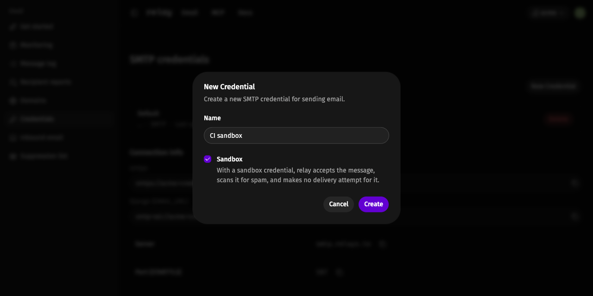
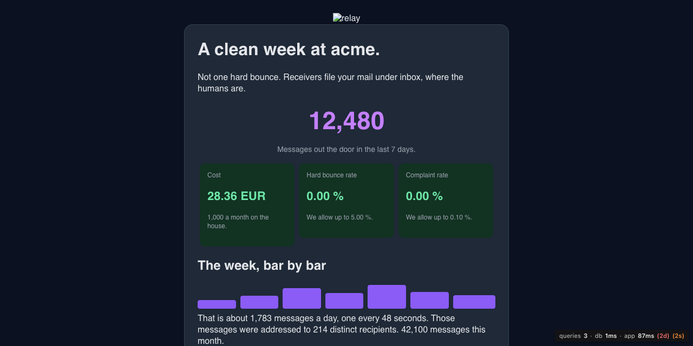
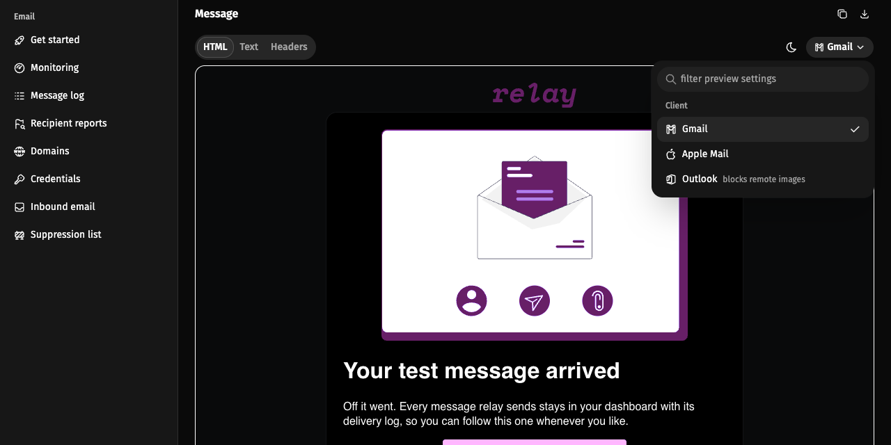
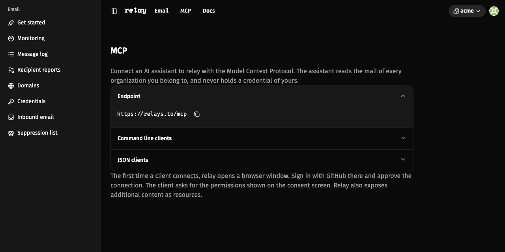
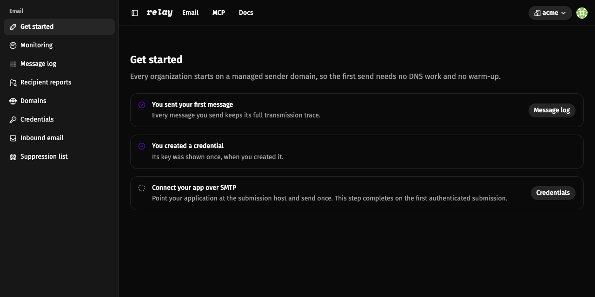

# Station log, stardate 2026.294

The wormhole is quiet. The relay is not. Four entries follow, in the order
they reached ops.



## Stardate 2026.271: the holosuite run

Not every message should leave the station.

A sandbox credential authenticates like any other SMTP credential. The
difference is what happens after submission.

relay scans the message for spam and stores it. It makes no delivery attempt.
The message ends in the terminal `sandboxed` status.

relay adds no DKIM signature, no `Feedback-ID`, and no platform cosign. The
stored copy is exactly what your application sent.

Sandbox traffic stays out of your reputation rates. A test suite cannot move
your bounce or complaint rate.

Create one on the credentials page and tick Sandbox. Use it in CI, staging, or
local development. Your tests follow the full submission path. The recipient
hears nothing.

A holosuite run leaves no trace on the station.

______________________________________________________________________



## Stardate 2026.273: the Monday report

Every Monday morning, active members receive a digest for each organization
they belong to.

The digest covers the last seven days. It reports messages sent, cost, hard
bounce rate, complaint rate, a daily bar chart, and the number of distinct
recipients. It adds the month so far and a link to monitoring.

The tone stays plain. A clean week gets a clean sentence. A week with no mail
says so. It is the quietest console on the station, and that is how it should
read.

______________________________________________________________________



## Stardate 2026.279: the other side of the link

A comm link looks different from the other end. Open a message with an HTML
body and choose a client in the preview controls.

- **Gmail** is the default. In dark mode it inverts the frame the way Gmail
  does.
- **Apple Mail** applies the dark styles your message carries.
- **Outlook** blocks remote images, as it does in the inbox.

The preview drops CSS the chosen client cannot apply. You see the fallbacks
your recipients see.

Images carried inside the message show in every client. Images the body
embeds as base64 show only in Apple Mail.

The client profiles come from caniemail.com and were checked in September
2026\.

______________________________________________________________________



## Stardate 2026.292: a new channel opens

A new subspace channel is open. relay now hosts a Model Context Protocol (MCP)
server at `https://relays.to/mcp`.

Connect an MCP client such as Claude, Cursor, or Codex. The first time the
client connects, relay opens a browser window. Sign in with GitHub and approve
the read-only scope.

The assistant can then:

- list sent and received messages across every organization you belong to,
- filter by direction, address, or status,
- open one message with its headers, spam and virus verdicts, and delivery
  summary,
- read relay's documentation and know-how as resources.

Your SMTP credentials stay out of the client. Access runs through OAuth, and
the consent screen lists the scope the client requests.

Open MCP in the dashboard and copy the endpoint, or run:

```shell
codex mcp add relay --url https://relays.to/mcp
```

______________________________________________________________________



## Supplemental log

Improvements and smaller items from the same month, logged for the record.

- **Getting started.** The first send is now a three-step checklist: send a
  test message, create a credential, connect over SMTP. The test message links
  to its own transmission trace, and the credential dialog shows the
  `smtps://` URI and a Django-compatible `smtp+ssl://` URI.
- **Domain setup.** The domain page splits the records into quick start,
  receiving, and production groups. Each record carries its own pass or fail
  state and its own copy buttons. A sending-only domain can skip the receiving
  and production groups. New domains open on their detail page right after
  creation.
- **Delivery retries.** A temporary delivery failure no longer loses mail. The
  station retries for about an hour on six attempts, with waits of 2, 4, 8, 16,
  and 32 minutes. Every answer stays on record. A 5xx rejection, an MTA-STS
  policy block, and a sender domain mismatch are still final.
- Transmission drawers now show the location of each peer IP on a small map.
  The lookup runs in your browser, and only when you open a drawer that
  carries an IP.
- Inbound messages record both ends of the SMTP connection.
- HTML previews now show images that travel inside the message.
- Message detail breadcrumbs carry the subject.
- Complaint attribution follows the authenticated provider domain and counts
  one complaint per message.
- Pages use shorter caches and ETags. A deploy no longer serves stale HTML.

relay is open source under AGPL-3.0. If something here does not work for your
setup, open an issue on
[GitHub](https://github.com/codingjoe/relay/issues). For the full reference,
read the [docs](https://relays.to/docs/).

The wormhole stays open. Keep the traffic moving.

Station out.
